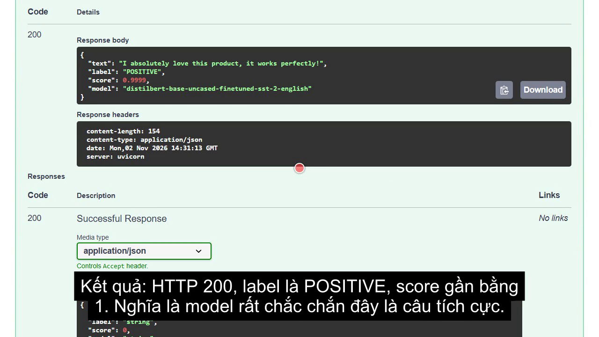

# Hugging Face Sentiment Analysis API

Web API xây dựng bằng FastAPI, dùng một model từ Hugging Face để phân tích cảm xúc của câu tiếng Anh.

## Video demo

[](https://github.com/lqbao110307/huggingface-sentiment-api/releases/download/v1.0/demo-video.mp4)

**[Xem video demo](https://github.com/lqbao110307/huggingface-sentiment-api/releases/download/v1.0/demo-video.mp4)**

## Thông tin sinh viên

- Họ và tên: Le Quoc Bao
- MSSV: 25127278
- Môn học: Computational Thinking, Khoa Công nghệ Thông tin, Trường ĐH Khoa học Tự nhiên, ĐHQG TP.HCM

## Model sử dụng

- Tên model: [`distilbert-base-uncased-finetuned-sst-2-english`](https://huggingface.co/distilbert/distilbert-base-uncased-finetuned-sst-2-english)
- Loại model: Sentiment analysis (text classification)
- Đầu vào: văn bản tiếng Anh
- Đầu ra: nhãn `POSITIVE` hoặc `NEGATIVE`, kèm độ tin cậy từ 0 đến 1

## Chức năng của hệ thống

| Endpoint | Chức năng |
|---|---|
| `GET /` | Giới thiệu hệ thống và các endpoint |
| `GET /health` | Kiểm tra trạng thái hệ thống và model |
| `POST /predict` | Nhận văn bản, gọi model và trả kết quả dạng JSON |
| `GET /docs` | Trang tài liệu tương tác do FastAPI tự sinh |

Các lỗi được xử lý và trả về dạng JSON:

| Tình huống | Mã HTTP |
|---|---|
| Thiếu `text`, `text` rỗng, sai kiểu, dài quá 2000 ký tự hoặc JSON sai định dạng | `422` |
| Model gặp lỗi trong quá trình suy luận | `500` |
| Model chưa tải được | `503` |

## Cấu trúc mã nguồn

```text
app/
  main.py      Ứng dụng FastAPI: các endpoint và xử lý lỗi
  model.py     Tải model Hugging Face và thực hiện dự đoán
  schemas.py   Định dạng và kiểm tra dữ liệu vào/ra
test_api.py    Test API bằng thư viện requests
requirements.txt
```

## Cài đặt

Yêu cầu Python 3.12. Dự án được kiểm thử với Python 3.12 trên Windows 11.

```bash
python -m venv .venv
```

Kích hoạt môi trường ảo:

```bash
# Windows
.venv\Scripts\activate

# macOS/Linux
source .venv/bin/activate
```

Cài các thư viện:

```bash
pip install -r requirements.txt
```

## Chạy ứng dụng

```bash
uvicorn app.main:app --port 8000
```

Lần chạy đầu tiên sẽ tải model từ Hugging Face nên cần có Internet. Khi khởi động xong, API chạy tại `http://127.0.0.1:8000` và trang tài liệu nằm tại `http://127.0.0.1:8000/docs`.

## Gọi API

### `GET /health`

```bash
curl http://127.0.0.1:8000/health
```

```json
{
  "status": "ok",
  "model": "distilbert-base-uncased-finetuned-sst-2-english",
  "model_loaded": true
}
```

### `POST /predict`

```bash
curl -X POST http://127.0.0.1:8000/predict -H "Content-Type: application/json" -d "{\"text\": \"I absolutely love this product, it works perfectly!\"}"
```

```json
{
  "text": "I absolutely love this product, it works perfectly!",
  "label": "POSITIVE",
  "score": 0.9999,
  "model": "distilbert-base-uncased-finetuned-sst-2-english"
}
```

Với câu `The service was terrible and I want my money back.`:

```json
{
  "text": "The service was terrible and I want my money back.",
  "label": "NEGATIVE",
  "score": 0.9997,
  "model": "distilbert-base-uncased-finetuned-sst-2-english"
}
```

`score` là độ tin cậy của nhãn được chọn, không phải mức độ tích cực.

### Ví dụ lỗi

Gửi `{}` sẽ nhận HTTP `422`:

```json
{
  "error": "Invalid input",
  "detail": ["text: Field required"]
}
```

## Test API

Khi server đang chạy, mở một terminal khác và chạy:

```bash
python test_api.py
```

Script gọi cả trường hợp hợp lệ lẫn không hợp lệ, rồi in kết quả từng trường hợp.
